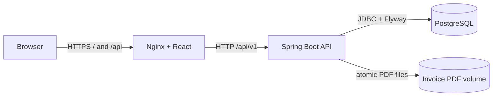
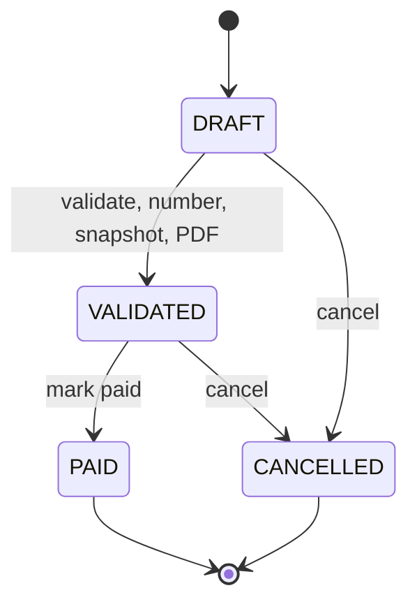

# Architecture

## System context

The application is a three-tier monorepo. A React single-page application calls a stateless Spring Boot REST API, which owns all authorization, lifecycle rules, numbering, financial calculations, snapshots, and PDF generation. PostgreSQL is the system of record; generated PDFs are durable application data and must be backed up with the database.

In Docker Compose, only Nginx is published. The backend and PostgreSQL remain on the private Compose network. TLS is expected at the deployment ingress or reverse proxy.

## Backend boundaries

The Java root package is `ma.facture.invoicing`. User-facing business modules are separated by capability: `auth`, `user`, `client`, `product`, and `invoice`. Legacy pricing code remains backend-only so historical invoice associations can still be read safely. Controllers translate HTTP requests, services own transactions and domain rules, repositories own persistence queries, DTOs define the external API, and entities model persisted state. Cross-cutting exception handling and configuration live in `common`, `config`, and `security`.

Flyway exclusively evolves the schema. Hibernate uses `ddl-auto=validate`, preventing it from silently changing production tables. PostgreSQL sequences and transactional upserts make client, product, and invoice numbering concurrency-safe.

## Frontend boundaries

The TypeScript frontend groups API clients, forms, pages, and tests by feature. TanStack Query owns server-state fetching and invalidation. React Hook Form and Zod own client-side input validation. The access token remains in memory; an HttpOnly refresh cookie supports session renewal. Financial values displayed while editing are previews only—the backend recalculates and persists authoritative totals.

## Invoice lifecycle

Validation is the irreversible commercial boundary. It checks current references and invoice terms, recalculates amounts, allocates the final annual number, snapshots mutable catalogue data, and publishes the PDF within coordinated transactional cleanup. Validated business data is immutable.

## Data ownership and recovery

The `invoice-postgres-data` volume contains relational state. The `invoice-pdf-data` volume contains immutable generated documents. A usable recovery point requires both to be captured from the same maintenance window. Application images contain no mutable business data.
